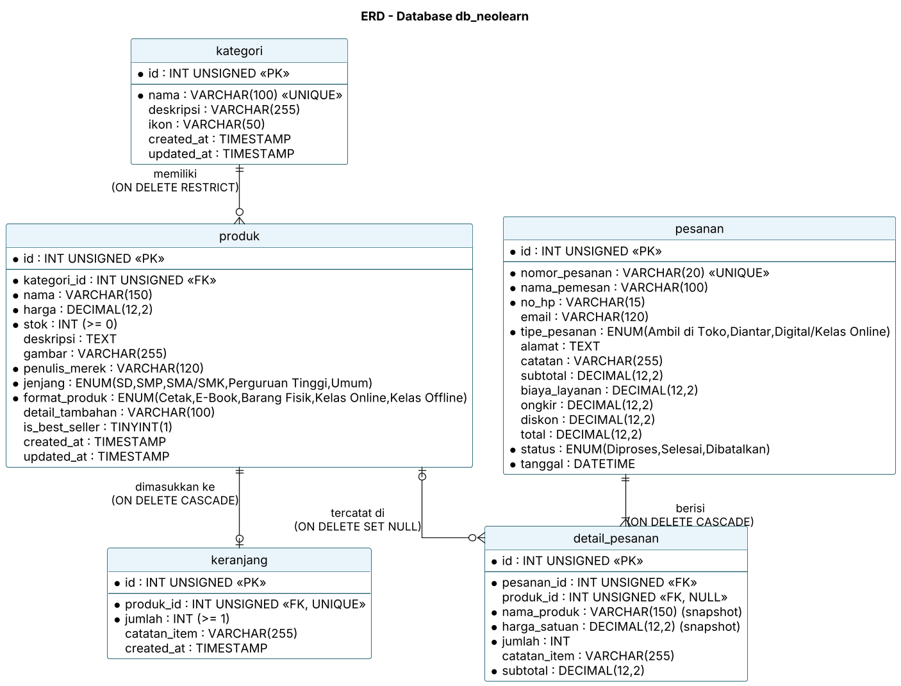

# ERD & Normalisasi — db_neolearn

Sumber diagram: [`diagram/erd.puml`](diagram/erd.puml)

## Relasi & Kardinalitas

| Relasi | Kardinalitas | Aturan FK |
|---|---|---|
| kategori → produk | 1 : N (satu kategori punya 0..N produk) | `ON DELETE RESTRICT`: kategori berisi produk tidak bisa dihapus |
| produk → keranjang | 1 : 0..1 (`UNIQUE produk_id`, produk tidak dobel di keranjang) | `ON DELETE CASCADE` |
| pesanan → detail_pesanan | 1 : N (minimal 1 item) | `ON DELETE CASCADE` |
| produk → detail_pesanan | 1 : N (0..N) | `ON DELETE SET NULL`: riwayat tetap ada walau produk dihapus |

## Normalisasi

### Bentuk tidak normal (UNF)
Bayangkan satu tabel "nota" berisi: `nomor_pesanan, tanggal, nama_pemesan, no_hp, alamat, {nama_produk, kategori, deskripsi_kategori, penulis, harga, jumlah, catatan}…, total`. Satu nota memiliki **grup berulang** (beberapa produk dalam satu baris).

### 1NF — nilai atomik, tanpa grup berulang
Grup berulang dipecah menjadi satu baris per item:
`(nomor_pesanan, tanggal, nama_pemesan, no_hp, alamat, nama_produk, kategori, deskripsi_kategori, penulis, harga, jumlah, catatan_item)`
dengan kunci komposit `(nomor_pesanan, nama_produk)`. Semua kolom sudah atomik, tetapi data pemesan berulang di setiap item.

### 2NF — hilangkan ketergantungan parsial
Atribut yang hanya bergantung pada sebagian kunci dipisahkan:
- `nomor_pesanan → tanggal, nama_pemesan, no_hp, email, alamat, tipe, biaya…` → tabel **pesanan** (PK surrogate `id`, `nomor_pesanan` UNIQUE).
- `nama_produk → kategori, penulis, harga, stok, …` → tabel **produk**.
- Atribut yang bergantung penuh pada (pesanan, produk): `jumlah, catatan_item, subtotal` → tabel **detail_pesanan**.

### 3NF — hilangkan ketergantungan transitif
Di tabel produk, `kategori → deskripsi_kategori` adalah ketergantungan transitif (`produk → kategori → deskripsi`). Kategori dipisah menjadi tabel **kategori**, dan produk cukup menyimpan `kategori_id` (FK).
Tabel **keranjang** berdiri sendiri (`produk_id, jumlah, catatan_item`) dan tidak menyimpan harga, karena harga selalu diambil lewat JOIN ke produk.

### Catatan desain (denormalisasi yang disengaja)
- `detail_pesanan.nama_produk` dan `harga_satuan` adalah **snapshot historis**. Nilainya sengaja disalin agar struk dan riwayat tidak berubah ketika produk diedit atau dihapus. Ini bukan redundansi transitif, karena nilainya bergantung pada *saat transaksi*, bukan pada produk saat ini.
- `pesanan.subtotal/diskon/total` disimpan sebagai **nilai final transaksi** (bukti pembayaran), dihitung server dalam transaksi checkout.

Hasil akhirnya adalah 5 tabel dalam 3NF: **kategori, produk, keranjang, pesanan, detail_pesanan**.
