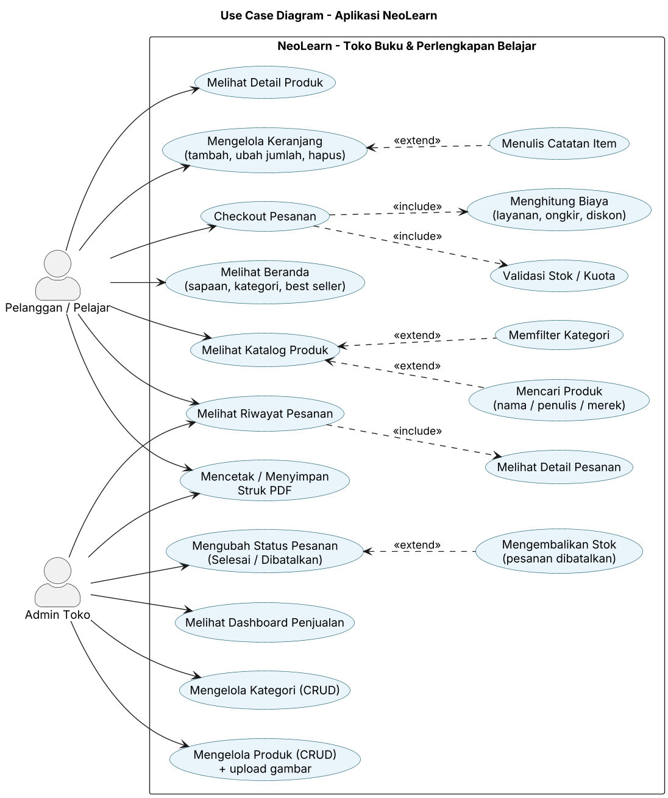
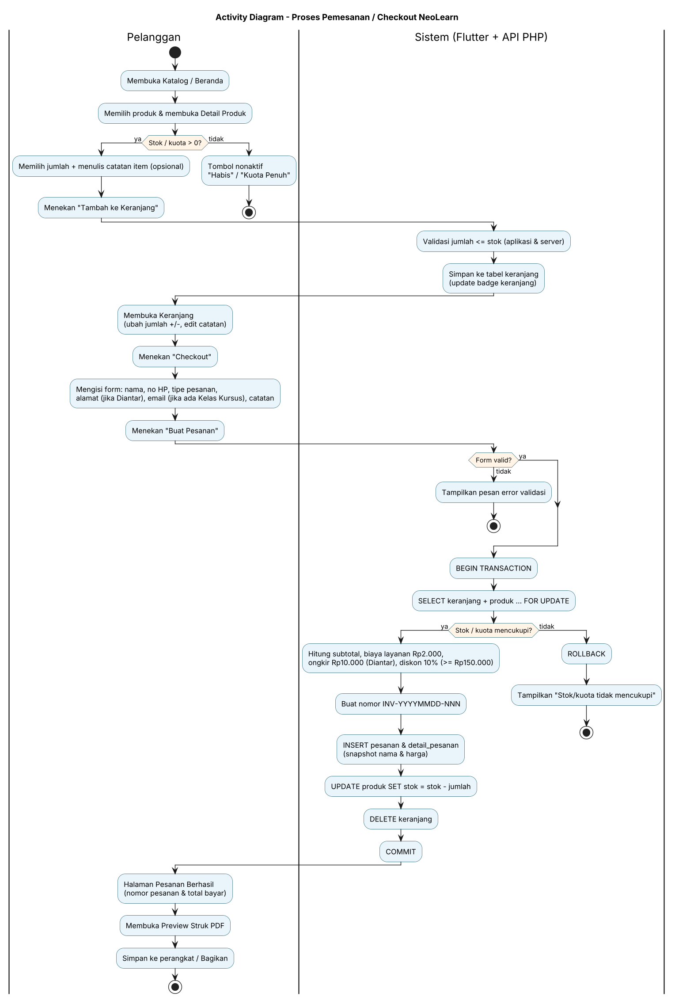

# Analisis Kebutuhan Sistem — NeoLearn

**Aplikasi:** NeoLearn — Toko Buku & Perlengkapan Belajar
**Penyusun:** Dhea Almas — NIRM 2023020113 — Kelas 7SIA6
**Platform:** Android (Flutter 3.41.6 + GetX) · REST API PHP · MySQL/MariaDB (XAMPP)

## 1. Deskripsi Singkat

NeoLearn adalah aplikasi mobile untuk toko **NeoLearn** yang menjual **buku pelajaran, buku referensi kuliah, alat tulis, dan kelas kursus**. Pelanggan dapat menelusuri katalog, mencari dan memfilter produk, menyimpan produk ke keranjang beserta catatan, lalu checkout. Admin toko dapat mengelola kategori dan produk, memproses status pesanan, mencetak struk PDF, dan memantau dashboard penjualan.

## 2. Aktor

| Aktor | Deskripsi |
|---|---|
| Pelanggan / Pelajar | Siswa, mahasiswa, atau orang tua yang membeli produk atau mendaftar kelas. |
| Admin Toko | Pengelola NeoLearn yang mengatur katalog, pesanan, dan laporan penjualan. |

## 3. Kebutuhan Fungsional

| Kode | Kebutuhan | Aktor |
|---|---|---|
| F-01 | Sistem menampilkan beranda berisi sapaan sesuai waktu (pagi/siang/sore/malam), daftar kategori, produk best seller, dan produk terbaru. | Pelanggan |
| F-02 | Sistem menampilkan katalog produk dalam bentuk grid. | Pelanggan |
| F-03 | Pengguna dapat mencari produk berdasarkan nama atau penulis/merek/pengajar secara realtime (debounce 400 ms). | Pelanggan |
| F-04 | Pengguna dapat memfilter katalog per kategori dengan ChoiceChip. Filter dapat dikombinasikan dengan pencarian. | Pelanggan |
| F-05 | Sistem menampilkan detail produk: gambar, nama, kategori, harga, stok/sisa kuota, penulis/merek/pengajar, badge jenjang, format, detail tambahan, dan deskripsi. | Pelanggan |
| F-06 | Pengguna dapat menambahkan produk ke keranjang beserta jumlah dan catatan item. Tombol nonaktif dan bertuliskan "Habis"/"Kuota Penuh" jika stok 0. | Pelanggan |
| F-07 | Pengguna dapat mengubah jumlah (+/−) di keranjang dengan validasi stok/kuota (min 1, maks stok), mengedit catatan, dan menghapus item. | Pelanggan |
| F-08 | Sistem menghitung subtotal per item, total keranjang, dan badge jumlah item secara otomatis (reaktif). | Sistem |
| F-09 | Pengguna dapat checkout dengan mengisi nama, nomor HP, tipe pesanan, alamat (wajib jika Diantar), email (wajib jika ada Kelas Kursus), dan catatan. | Pelanggan |
| F-10 | Sistem menghitung biaya layanan Rp2.000, ongkir Rp10.000 (Diantar), diskon pelajar 10% (subtotal ≥ Rp150.000), dan total bayar. | Sistem |
| F-11 | Sistem membuat nomor pesanan otomatis `INV-YYYYMMDD-NNN` (urutan reset setiap hari). | Sistem |
| F-12 | Sistem menyimpan pesanan & detail pesanan, mengurangi stok, dan mengosongkan keranjang dalam satu transaksi database. | Sistem |
| F-13 | Pengguna dapat melihat riwayat pesanan urut terbaru dengan warna status berbeda dan filter status. | Pelanggan, Admin |
| F-14 | Pengguna dapat melihat detail pesanan: item, catatan item, rincian biaya, dan info pemesan. | Pelanggan, Admin |
| F-15 | Admin dapat mengubah status pesanan Diproses → Selesai/Dibatalkan dengan dialog konfirmasi. Jika dibatalkan, stok/kuota dikembalikan. | Admin |
| F-16 | Sistem membuat struk PDF, menampilkan preview, menyimpan ke perangkat, dan membagikannya. | Pelanggan, Admin |
| F-17 | Admin dapat menambah, melihat, mengubah, dan menghapus kategori. Nama tidak boleh kosong atau duplikat. Kategori yang masih punya produk tidak bisa dihapus. | Admin |
| F-18 | Admin dapat menambah, melihat, mengubah, dan menghapus produk, termasuk upload gambar dari galeri, penulis/merek/pengajar, jenjang, format, detail tambahan, dan best seller. | Admin |
| F-19 | Sistem menampilkan dashboard: total pesanan, total pendapatan (pesanan Selesai), produk terlaris, BarChart 5 produk terlaris, LineChart pendapatan 7 hari, dan PieChart penjualan per kategori. | Admin |
| F-20 | Sistem menampilkan pesan sukses/gagal (snackbar), indikator loading, dan tampilan error dengan tombol "Coba Lagi". | Sistem |

## 4. Kebutuhan Non-Fungsional

| Kode | Kategori | Kebutuhan |
|---|---|---|
| NF-01 | Performa | Respons API untuk daftar produk < 1 detik di jaringan lokal. Pencarian memakai debounce 400 ms agar tidak membanjiri server. Gambar di-cache (`cached_network_image`). |
| NF-02 | Usability | Antarmuka berbahasa Indonesia, warna konsisten dengan logo NeoLearn, label stok berubah menjadi "Kuota Peserta"/"Sisa kuota" untuk kelas, dan pesan error yang jelas. |
| NF-03 | Keamanan data | Semua query memakai PDO prepared statement (anti SQL injection). Validasi dilakukan di aplikasi dan server. Upload hanya menerima JPG/PNG/WEBP ≤ 2 MB, nama file dibuat server, dan eksekusi script di folder `uploads/` diblokir. |
| NF-04 | Integritas | Checkout dan pembatalan memakai transaksi (`BEGIN … FOR UPDATE … COMMIT/ROLLBACK`). Foreign key InnoDB dan constraint CHECK (stok ≥ 0, harga > 0). |
| NF-05 | Kompatibilitas | Android 5.0+ (minSdk Flutter 3.41), di emulator maupun HP fisik. HTTP lokal diizinkan di APK release (`network_security_config.xml`). |
| NF-06 | Keandalan | Server mati/timeout, respons kosong atau bukan JSON, dan stok habis ditangani tanpa crash. |
| NF-07 | Maintainability | Arsitektur GetX terpisah (models, controllers, views, routes, services, bindings, widgets, theme, utils). Konstanta biaya terpusat di `api_config.dart` dan `config/database.php`. |
| NF-08 | Portabilitas | Base URL API dapat diganti di satu file atau lewat `--dart-define=API_BASE_URL=...`. |

## 5. Aturan Bisnis

1. Biaya layanan Rp2.000 per pesanan.
2. Ongkir Rp10.000 hanya untuk tipe **Diantar**. Ambil di Toko dan Digital/Kelas Online gratis ongkir.
3. Diskon pelajar 10% dari subtotal jika subtotal ≥ Rp150.000.
4. Total = subtotal + biaya layanan + ongkir − diskon.
5. Tipe **Digital/Kelas Online** hanya boleh dipilih jika semua item berformat E-Book atau Kelas Online.
6. Email wajib jika keranjang berisi produk kategori **Kelas Kursus**.
7. Untuk Kelas Kursus, kolom `stok` berarti **sisa kuota peserta**.
8. Pesanan berstatus Selesai/Dibatalkan tidak dapat diubah lagi. Pembatalan mengembalikan stok/kuota.
9. Pendapatan dashboard hanya dihitung dari pesanan **Selesai**. Produk terlaris tidak termasuk pesanan **Dibatalkan**.

## 6. Diagram

- Use Case: [`diagram/use_case.puml`](diagram/use_case.puml) → 
- Activity Checkout: [`diagram/activity_checkout.puml`](diagram/activity_checkout.puml) → 
- ERD & normalisasi: [`erd_normalisasi.md`](erd_normalisasi.md)
